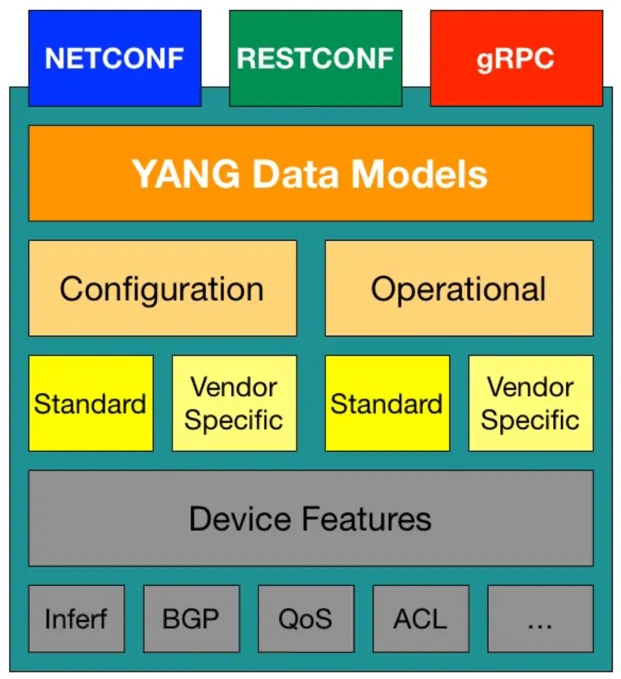

# YANG (Yet Another Next Generation)

YANG is a data modeling language used to describe the configuration and operational data of network devices such as routers, switches, and firewalls. It defines the structure of network management data, including the hierarchy of configuration elements, allowed data types, constraints, and relationships between fields.

## Why YANG Was Introduced

Earlier approaches to network management relied on SNMP for monitoring and CLI for configuration. However, SNMP's data models were relatively rigid, and automating CLI interactions was fragile due to reliance on text parsing (commonly referred to as **screen scraping**). These limitations are discussed in detail in [Network Management Protocols](./06_README_network_management.md).

To address these challenges, the networking industry moved toward model-driven network management. This approach separates the data model from the transport protocol, allowing devices and management systems to exchange structured data defined by a common schema. YANG was standardized by the IETF as the data modeling language for this purpose.

## What YANG Does

YANG acts as a schema for network device data. For example, if a network operator needs to configure an interface IP address or retrieve interface statistics, the YANG model defines the exact structure of those data elements, their types, and any valid ranges. This ensures that both network devices and management systems interpret configuration and operational data in a consistent and predictable way.

Unlike SNMP MIBs, which were primarily designed for monitoring, YANG was built to support both configuration management and operational state retrieval. Its hierarchical data model makes it possible to represent complex device configurations in a structured and vendor-neutral way. This enables automation platforms to interact with devices from different vendors using a consistent schema.

## YANG in Practice: A Network Interface Example

To illustrate how YANG models network device data, the following example defines a simplified model for network interfaces. This model includes configurable properties such as the interface name and administrative status, as well as read-only traffic counters that a telemetry system would stream to a collector.

```yang
module simple-interface {
    yang-version 1.1;
    namespace "urn:example:simple-interface";
    prefix "sif";

    revision 2026-01-15 {
        description "Initial revision";
    }

    container interfaces {
        description "Top-level container for network interfaces";

        list interface {
            key "name";
            description "List of network interfaces on the device";

            leaf name {
                type string;
                description "Interface name, e.g., Ethernet0";
            }

            leaf admin-status {
                type enumeration {
                    enum up;
                    enum down;
                }
                description "Administrative state of the interface";
            }

            leaf mtu {
                type uint16 {
                    range "68..9216";
                }
                description "Maximum transmission unit in bytes";
            }

            container counters {
                config false;
                description "Interface traffic counters (read-only operational state)";

                leaf in-octets {
                    type uint64;
                    description "Total bytes received on the interface";
                }

                leaf out-octets {
                    type uint64;
                    description "Total bytes transmitted from the interface";
                }

                leaf in-errors {
                    type uint32;
                    description "Number of inbound packets with errors";
                }
            }
        }
    }
}
```

This module uses several core YANG constructs:

- **`container`** groups related nodes into a logical subtree. Here, `interfaces` is the top-level grouping and `counters` groups the traffic statistics under each interface.

- **`list`** represents a collection of entries identified by a key. The `interface` list allows the model to describe multiple interfaces on a single device, each uniquely identified by its `name`.

- **`leaf`** defines an individual data element with a specific type. For example, `mtu` is a `uint16` constrained to the range 68–9216.

- **`config false`** marks a subtree as read-only operational state. The `counters` container cannot be written to by a client — it reflects live data reported by the device. This distinction between configuration data and operational state is central to how YANG models are used in telemetry.

Tools such as [pyang](https://github.com/mbj4668/pyang) can generate a tree representation of any YANG model. Running `pyang -f tree simple-interface.yang` on this module produces the following output:

```text
module: simple-interface
  +--rw interfaces
     +--rw interface* [name]
        +--rw name            string
        +--rw admin-status?   enumeration
        +--rw mtu?            uint16
        +--ro counters
           +--ro in-octets?    uint64
           +--ro out-octets?   uint64
           +--ro in-errors?    uint32
```

In this tree, `rw` indicates read-write (configurable) nodes while `ro` indicates read-only (operational) nodes. The `*` after `interface` shows it is a list, and the `?` after a leaf name means the leaf is optional. Notice how the `counters` subtree is marked `ro` because of the `config false` statement — this is the telemetry data that a collector would subscribe to.

> For a detailed walkthrough of YANG syntax, including built-in types, derived types, import and include mechanisms, list and choice constructs, XPath constraints, and YIN, see the [YANG Language Reference](./05a_README_yang_syntax.md). To understand how YANG models enforce data correctness at runtime, see [YANG Validation](./05b_README_yang_validation.md).

## Standard Vs. Vendor-Specific YANG Models

YANG models can be developed by standards organizations or individual vendors.

**Standardized** models, typically developed through the IETF, define common structures for widely used network protocols and services. These models enable interoperability between devices from different vendors. These models are developed within working groups, and their creation process involves community input, drafts, and consensus before reaching publication as RFCs.

Companies that produce network hardware and software (like Cisco, Juniper, Huawei, Arista, and others) create their own models to represent the configuration and operational data for their devices. These models often extend or specialize standard models to cover **vendor-specific** features or provide detailed models for proprietary technologies.

It is common for different vendors to create their own YANG models for the same network protocols or services. This situation arises because while a protocol itself may be standardized, different vendors might implement the protocol with vendor-specific features or extensions that are not covered by the standard models or they may choose to model standard features in ways that align more closely with their particular device architectures and management philosophies.



The existence of both standard and vendor-specific YANG models means that network operators often need to work with a mix of model types to fully manage their networks, especially in multi-vendor environments. This can complicate network management but also offers the flexibility to leverage the best features and capabilities of each vendor's devices. Tooling and platforms that can abstract these differences and normalize configurations across devices can help mitigate some of the complexity introduced by vendor-specific models.

## OpenConfig YANG Models

OpenConfig is an effort among multiple network operators to develop and deploy vendor-neutral data models for configuring and managing networks in a standardized and simplified manner. It represents a collaborative initiative aimed at moving network configuration away from traditional, vendor-specific interfaces towards a more open, model-driven approach.

OpenConfig's primary focus is on creating YANG models that are directly usable for automating the configuration and management of network devices. OpenConfig data models are written in YANG v1.0. The official distribution channel for OpenConfig YANG models is [this](https://github.com/openconfig/public/) public GitHub repository. You can find the documentation [here](https://openconfig.net/projects/models/schemadocs/).

> YANG data models are used by several network management protocols including NETCONF, RESTCONF, and gNMI. These protocols and their relationship to YANG are covered in [Network Management Protocols](./06_README_network_management.md) and [gNMI](./08_README_gnmi.md).
