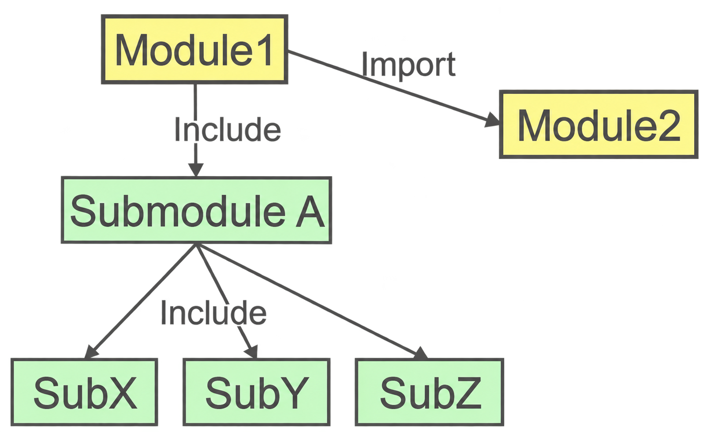
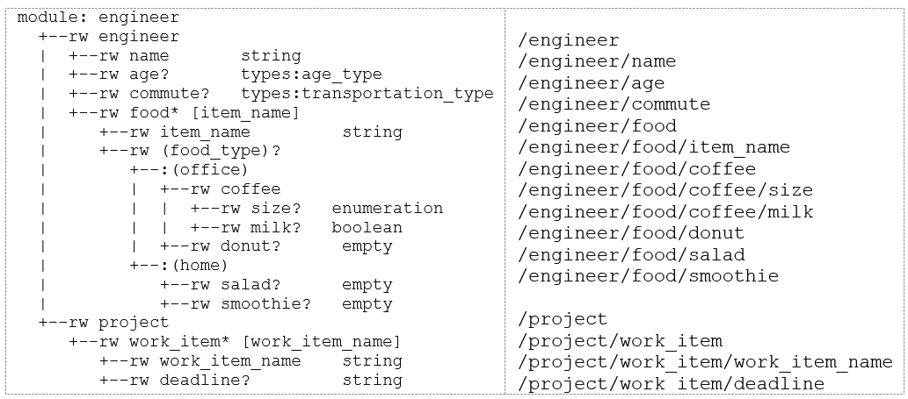

# YANG Module Structure

A YANG module defines a complete data model. Each module typically contains three major sections:

- Module header statements: identify the module and its namespace.
- Revision statements: track the history of changes made to the module.
- Definition statements: describe the actual data structures.

Let us go over a sample YANG module. The name of this YANG module is `engineer` and it represents a data model for engineers in a company. We will add more items into this YANG module later on.

```yang
module engineer {
    yang-version 1.1;
    namespace "urn:nokia.com:srexperts:engineer";
    prefix "engineer";
    revision 2019-05-06;
    container engineer {
        description "Engineer record";
        leaf name {
            mandatory true;
            type string;
        }
        leaf age {
            type uint8;
        }
    }
}
```

The `yang-version` statement specifies which version of the YANG language specification the module conforms to — it is not the version of the module itself. The two possible values are `1.0` and `1.1`. If the statement is omitted, the module defaults to YANG version 1.0. For new modules, starting with version 1.1 is recommended.

The `namespace` statement defines the XML namespace that all identifiers defined by the module are qualified by in the XML encoding. The argument to the namespace statement is the URI of the namespace.

The `prefix` is a short name used to reference the module. The prefix string can be combined with a definition name to form a qualified reference, for example `if:ifName`.

The `revision` statement specifies the editorial revision history of the module, including the initial revision. A series of revision statements detail the changes in the module's definition. The argument is a date string in the format "YYYY-MM-DD", followed by a block of sub-statements that holds detailed revision information. A module should have at least one revision statement. Note that for every published editorial change, a new one should be added in front of the revisions sequence so that all revisions are in reverse chronological order.

A `container` is used to group related nodes in a subtree. A container has only child nodes and no value. It may contain any number of child nodes of any type (including other containers). A short description should be added for every container. Inside a container, data elements called `leaf` nodes hold individual values. A container can be thought of as a branch in a tree, while leaves are the endpoints of a branch where actual data resides. Containers and leaves are organized hierarchically: containers can be nested inside other containers, but a leaf cannot contain child nodes.

In the example above, the `engineer` container has two leaves. The `leaf` keyword declares a data element, followed by its name. In this case, the first leaf is called `name` and its type is the built-in YANG type `string`. Built-in YANG types are covered in a later section. The `mandatory` statement accepts a boolean value and should be set to `true` if the leaf is required. If omitted, it defaults to `false`, meaning the leaf is optional.

## YANG Tree Structure

YANG models represent configuration and operational data as a hierarchical tree. Each node in the tree corresponds to a data element defined in the YANG model.

Tools such as [pyang](https://github.com/mbj4668/pyang) can generate a tree representation of the model. Pyang is an open source tool that allows users to compile a YANG module in order to validate and visualize the YANG model in various output formats.

Save the YANG module that we discussed in the previous section into a file and name it `engineer.yang`. It is good practice to use the module name as the YANG filename (pyang and other similar tools will flag a warning if the names are not the same). Ensure that your system has pyang installed. From the same directory as the YANG file, invoke the following command:

    pyang -f tree engineer.yang

The tree representation of the YANG module is shown below:

```text
module: engineer
  +--rw engineer
     +--rw name    string
     +--rw age?    uint8
```

Each node is printed as:

    <status>--<flags> <name><opts> <type> <if-features>

For example, the leaf node `age` is printed as:

    +--rw age?

In this representation:

- `+` indicates the node is current
- `rw` indicates read-write configuration data
- `?` indicates the node is optional

This tree representation helps engineers understand how configuration data is organized inside the model. Refer to the output of `pyang --tree-help` for more detailed information.

## Built-in Types in YANG

YANG provides a set of built-in data types. These types are similar to those found in programming languages but include additional constraints useful for network management. The following table summarizes the built-in types in YANG.

| **Type**              | **Description**                     |
| --------------------- | ----------------------------------- |
| `uint8`               | 8-bit unsigned integer              |
| `uint16`              | 16-bit unsigned integer             |
| `uint32`              | 32-bit unsigned integer             |
| `uint64`              | 64-bit unsigned integer             |
| `int8`                | 8-bit **signed** integer            |
| `int16`               | 16-bit **signed** integer           |
| `int32`               | 32-bit **signed** integer           |
| `int64`               | 64-bit **signed** integer           |
| `decimal64`           | 64-bit **signed** decimal number    |
| `string`              | A character string                  |
| `boolean`             | Boolean value (`true` or `false`)   |
| `bits`                | A set of bits or flags              |
| `binary`              | Any binary data                     |
| `empty`               | A leaf that does not have any value |
| `enumeration`         | One of an enumerated set of strings |
| `union`               | Choice of member types              |
| `identityref`         | A reference to an abstract identity |
| `instance-identifier` | A reference to a data tree node     |
| `leafref`             | A reference to a leaf instance      |

## Derived Types in YANG

YANG can also define derived types from base types using the `typedef` statement. A base type can be either a built-in type or a derived type, allowing a hierarchy of derived types. A derived type can be used as the argument for the `type` statement. Here is an example that defines a derived type called `percent`.

```yang
typedef percent {
    type uint8 {
        range "0 .. 100";
    }
}

leaf completed {
    type percent;
}
```

Let us improve our `engineer` module by leveraging derived types. We will create a typedef called `age_type` that constrains the age to a valid working range — 18 (minimum working age) through 110 (maximum retirement age). The `range` statement defines this constraint, and the `..` operator inside a range expression means "from … to" (inclusive on both ends). The `units` statement documents the measurement unit of the value.

```yang
module engineer {
    yang-version 1.1;
    namespace "urn:nokia.com:srexperts:engineer";
    prefix "engineer";
    revision 2019-05-06;
    typedef age_type {
        description "Engineers start work at 18 and retire by 110";
        type uint8 {
            range "18 .. 110";
        }
        units years;
    }
    container engineer {
        description "Engineer record";
        leaf name {
            mandatory true;
            type string;
        }
        leaf age {
            type age_type;
        }
    }
}
```

## Import and Include in YANG

Large YANG models are often divided into multiple files to improve organization, reuse, and maintainability. YANG provides two mechanisms for referencing definitions across files: `include` and `import`. Although both allow one file to reference definitions from another, they serve different purposes and operate under different namespace rules.

| Feature              | `include`                                                      | `import`                                                  |
| -------------------- | -------------------------------------------------------------- | --------------------------------------------------------- |
| **Target**           | Submodules belonging to the same module                        | Completely separate modules                               |
| **Namespace**        | Same namespace as the parent module                            | Different namespace from the calling module               |
| **Prefix Required?** | No                                                             | Yes                                                       |
| **Primary Purpose**  | File organization (splitting one large module into submodules) | Code reuse (leveraging definitions from external modules) |

A submodule is a portion of a larger YANG module that has been separated into its own file for readability or maintainability. Even though the definitions are distributed across multiple files, they still logically belong to a single module. From the perspective of systems using the model, the module and all its submodules appear as one unified data model.



The `include` statement is used to incorporate a submodule into its parent module. Because the submodule belongs to the same module, it shares the same namespace and prefix as the parent. This means definitions inside the submodule can be referenced directly without adding a prefix. The primary purpose of `include` is therefore file organization, allowing a large module to be split into smaller pieces while still forming a single logical model.

The `import` statement, on the other hand, is used to reference definitions from a completely separate YANG module. Since each module has its own namespace, importing a module requires assigning a prefix. This prefix is used to qualify any types, groupings, or other definitions taken from the imported module. Using prefixes prevents naming conflicts when multiple modules define similarly named elements.

In practice, `import` is commonly used to reuse definitions that are shared across multiple modules. For example, a module might import common data types or reusable structures defined in another module. This encourages modular design and avoids duplicating the same definitions in multiple places.

Consider a module named `engineer_types.yang` that defines reusable data types. These types can then be imported and referenced from another module. This module defines two reusable types: `age_type` and `transportation_type`.

engineer_types.yang

```yang
module engineer_types {
    yang-version 1.1;
    namespace "urn:nokia.com:srexperts:types";
    prefix "types";
    revision 2019-05-06;
    typedef age_type {
        description "Engineers start work at 18 and retire by 110";
        type uint8 {
            range "18 .. 110";
        }
        units years;
    }
    typedef transportation_type {
        description "Method of transportation";
        type enumeration {
            enum foot;
            enum bicycle;
            enum car;
            enum bus;
            enum train;
            enum boat;
            enum aeroplane;
        }
    }
}
```

A second module, `engineer.yang`, can import these definitions.

engineer.yang

```yang
module engineer {
    yang-version 1.1;
    namespace "urn:nokia.com:srexperts:engineer";
    prefix "engineer";
    import engineer_types {
        prefix "types";
    }
    revision 2019-05-06;
    container engineer {
        description "Engineer record";
        leaf name {
            mandatory true;
            type string;
        }
        leaf age {
            type types:age_type;
        }
        leaf commute {
            type types:transportation_type;
        }
    }
}
```

In this example, the `engineer` module imports the `engineer_types` module and assigns it the prefix `types`. When referencing the imported definitions, the prefix is used (for example, `types:age_type`). This tells the YANG compiler exactly which module the type belongs to.

When a YANG compiler processes a module, it resolves dependencies by following any `import` or `include` statements encountered in the module header. The compiler loads the referenced modules or submodules so that all type definitions, groupings, and structures can be properly validated. For this reason, YANG specifications require that `import` and `include` statements appear in the header section of a module, before the main body of the data model.

## Grouping and Uses in YANG

When the same set of nodes appears in multiple places within a data model, duplicating them creates a maintenance burden. YANG provides the `grouping` and `uses` statements to solve this. A `grouping` defines a reusable collection of nodes, and a `uses` statement references that grouping to insert its nodes at a particular location in the tree. This is similar to a function or template in programming — define once, use many times.

Suppose every engineer needs both a `phone` and an `email` leaf. Rather than repeating those leaves in every container that requires contact information, we can define them once as a grouping inside our `engineer_types` module.

engineer_types.yang (add the grouping alongside the existing typedefs)

```yang
grouping contact-info {
    description "Reusable contact information";
    leaf phone {
        type string;
    }
    leaf email {
        type string;
    }
}
```

The `engineer` module can then pull in this grouping with a single `uses` statement.

engineer.yang (updated)

```yang
module engineer {
    yang-version 1.1;
    namespace "urn:nokia.com:srexperts:engineer";
    prefix "engineer";
    import engineer_types {
        prefix "types";
    }
    revision 2019-05-06;
    container engineer {
        description "Engineer record";
        leaf name {
            mandatory true;
            type string;
        }
        leaf age {
            type types:age_type;
        }
        leaf commute {
            type types:transportation_type;
        }
        uses types:contact-info;
    }
}
```

The line `uses types:contact-info` tells the YANG compiler to insert the `phone` and `email` leaves defined in the `contact-info` grouping into the `engineer` container. Because the grouping is defined in a separate module (`engineer_types`), the `uses` statement must include the prefix. The resulting tree now includes the contact leaves:

```text
module: engineer
  +--rw engineer
     +--rw name       string
     +--rw age?       types:age_type
     +--rw commute?   types:transportation_type
     +--rw phone?     string
     +--rw email?     string
```

Groupings can contain any type of data node — leaves, containers, lists, and even nested `uses` references. A `uses` statement can also include a `refine` sub-statement to override properties of the grouping's nodes at the point of use, such as changing a default value or adding a `must` constraint. This flexibility makes groupings one of the primary mechanisms for building modular, maintainable YANG models.

## Augment in YANG

The `import` statement lets a module reference definitions *from* another module. The `augment` statement does the opposite — it lets a module inject new nodes *into* another module's schema tree, without modifying the original module's file.

This is a key design principle in YANG: modules can be extended from the outside. A vendor can augment a standard model to add proprietary leaves, or a separate team can add fields to a shared model without coordinating edits to the same file. The `augment` statement takes a schema node path as its argument. This path identifies the target node in the other module's tree where the new nodes will be inserted.

Let's create a new module, `engineer_security.yang`, that augments our `engineer` container to add a `clearance_level` leaf. This represents information managed by the security team, kept separate from the core engineer model.

engineer_security.yang

```yang
module engineer_security {
    yang-version 1.1;
    namespace "urn:nokia.com:srexperts:security";
    prefix "security";
    import engineer {
        prefix "eng";
    }
    revision 2019-05-06;
    augment "/eng:engineer" {
        description "Security team additions to the engineer model";
        leaf clearance_level {
            type enumeration {
                enum public;
                enum confidential;
                enum secret;
            }
            default public;
            description "Security clearance level of the engineer";
        }
    }
}
```

The `augment "/eng:engineer"` statement targets the `engineer` container defined in the `engineer` module. The path uses the prefix `eng` that was assigned during import. Inside the `augment` block, we define a new `clearance_level` leaf. After augmentation, the combined tree looks like this:

```text
module: engineer
  +--rw engineer
     +--rw name              string
     +--rw age?              types:age_type
     +--rw commute?          types:transportation_type
     +--rw phone?            string
     +--rw email?            string
     +--rw clearance_level?  enumeration
```

The original module (`engineer.yang`) is never modified. The `clearance_level` leaf exists only because `engineer_security.yang` is loaded alongside it. If the security module is removed, the original model reverts to its prior shape. A few additional points about `augment`:

- The augmented path must refer to an existing node in the target module's schema tree.
- `augment` can add any type of data node — leaves, containers, lists, choices, and more.
- A `when` sub-statement can be placed inside the `augment` block to make the injected nodes conditional.
- Augmentation is commonly used in the networking industry where standards bodies define base models (such as IETF or OpenConfig) and vendors augment them with device-specific features.

## List and Choice in YANG

Our YANG model now includes derived types and several leaves. We can enhance it further with two common YANG constructs: **lists** and **choices**. To demonstrate, we will add a `project` container (a separate branch inside the `engineer` container) and a `food` list.

Since an engineer can work on zero or more work items, we create a `list` called `work_item`. This list has two leaves: `work_item_name` and `deadline`. Every list requires a `key` statement that identifies one or more leaves used to uniquely distinguish each entry. Here, the key is `work_item_name`.

The `ordered-by` statement defines whether the order of entries within a list is determined by the user or the system. The argument is one of the strings `system` or `user`. If not present, ordering defaults to `system`. System-ordered lists can appear in any order the server deems appropriate — this is common when the processing of one entry does not depend on another. User-ordered lists preserve the sequence in which entries are created, which matters when processing order is significant.

```yang
container engineer {
    container project {
        list work_item {
            key "work_item_name";
            ordered-by user;
            leaf work_item_name {
                type string;
            }
            leaf deadline {
                type string;
            }
        }
    }
}
```

YANG allows the data model to segregate incompatible nodes into distinct choices using the `choice` and `case` statements.  The `choice` statement contains a set of case statements that define sets of schema nodes that cannot appear together. Each case may contain multiple nodes, but each node may appear in only one case under a choice.

```yang
container engineer {
    list food {
        key "item_name";
        ordered-by system;
        leaf item_name {
            type string;
        }
        choice food_type {
            case office {
                container coffee {
                    leaf size {
                        type enumeration {
                            enum tall;
                            enum grande;
                            enum venti;
                        }
                    }
                    leaf milk {
                        type boolean;
                    }
                }
                leaf donut {
                    type empty;
                }
            }
            case home {
                leaf salad {
                    type empty;
                }
                leaf smoothie {
                    type empty;
                }
            }
        }
    }
}
```

The new YANG tree will look like this:

```text
module: engineer
  +--rw engineer
     +--rw name              string
     +--rw age?              types:age_type
     +--rw commute?          types:transportation_type
     +--rw food* [item_name]
     |  +--rw item_name         string
     |  +--rw (food_type)?
     |     +--:(office)
     |     |  +--rw coffee
     |     |  |  +--rw size?   enumeration
     |     |  |  +--rw milk?   boolean
     |     |  +--rw donut?      empty
     |     +--:(home)
     |        +--rw salad?      empty
     |        +--rw smoothie?   empty
     +--rw project
        +--rw work_item* [work_item_name]
           +--rw work_item_name    string
           +--rw deadline?         string
```

## Extension in YANG

YANG's built-in statements (`leaf`, `container`, `list`, `must`, `when`, and so on) cover the constructs needed to describe data models. However, some use cases require metadata or behavior that no built-in statement provides. The `extension` statement (RFC 7950 §7.19) lets a module author define a custom keyword that other modules can use. If `typedef` is the mechanism for creating custom *types*, then `extension` is the mechanism for creating custom *keywords*.

An extension has two parts:

1. **Definition** — The module that owns the extension uses the `extension` statement to declare the keyword's name and, optionally, an `argument` that the keyword accepts.

2. **Usage** — Any module that imports the defining module can apply the custom keyword via the prefix, just like a typedef is referenced via a prefix.

Suppose we want to annotate YANG nodes with a URL pointing to their external documentation. No built-in YANG statement does this, so we define an extension.

doc_extensions.yang

```yang
module doc_extensions {
    yang-version 1.1;
    namespace "urn:example:doc";
    prefix "doc";
    revision 2019-05-06;
    extension doc-url {
        argument "url";
        description
            "Annotates a node with a URL to its external documentation.";
    }
}
```

The `extension doc-url` statement declares a new keyword called `doc-url` that takes a single argument named `url`. By itself, this declaration does nothing — it simply makes the keyword available for other modules to use.

Our `engineer` module can now import `doc_extensions` and apply the custom keyword to annotate individual nodes.

engineer.yang (updated with extension usage)

```yang
module engineer {
    yang-version 1.1;
    namespace "urn:nokia.com:srexperts:engineer";
    prefix "engineer";
    import engineer_types {
        prefix "types";
    }
    import doc_extensions {
        prefix "doc";
    }
    revision 2019-05-06;
    container engineer {
        doc:doc-url "https://wiki.example.com/engineer-model";
        description "Engineer record";
        leaf name {
            mandatory true;
            type string;
        }
        leaf age {
            type types:age_type;
        }
        leaf commute {
            type types:transportation_type;
        }
        uses types:contact-info;
    }
}
```

The line `doc:doc-url "https://wiki.example.com/engineer-model"` uses the custom keyword. The prefix `doc` resolves to the `doc_extensions` module, and `doc-url` is the extension keyword defined there. The string argument is the URL value. A YANG compiler recognizes this as a valid extension usage and preserves the annotation in the data model.

Extensions are the mechanism that makes YANG open-ended. Real-world systems use them extensively:

- **SONiC** defines a [`sonic-extension`](https://github.com/sonic-net/sonic-buildimage/blob/master/src/sonic-mgmt-common/models/yang/sonic/common/sonic-extension.yang) module with extensions such as `sonic-ext:db-name`, `sonic-ext:custom-validation`, and `sonic-ext:dependent-on` to map YANG models to the SONiC Redis datastore and hook platform-specific validation logic. See [YANG-to-Redis Translation — SONiC Extension Definitions](05d_README_yang_translation_sonic.md#sonic-extension-definitions) for detailed examples from upstream code.

- **OpenConfig** defines `oc-ext:openconfig-version` to embed semantic version numbers in modules.

- **IETF** defines extensions in modules like `ietf-yang-metadata` (RFC 7952) to attach metadata to YANG data instances.

In each case the pattern is the same: one module declares the extension keyword, and other modules import it and apply it wherever needed. Combined with `augment`, this creates a powerful overlay model — a module can augment a third-party data model and attach extension-defined annotations to it, all without modifying the original module.

## YIN

A YANG module can be translated into an alternative XML-based syntax called `YIN`. The translated module is called a YIN module. The YANG and YIN formats contain equivalent information using different notations. The YIN notation enables developers to represent YANG data models in **XML** and therefore use the rich set of XML-based tools for data filtering and validation, automated generation of code and documentation, and other tasks. Tools like `XSLT` or XML validators can be utilized.

A YANG module can be translated into YIN syntax without losing any information. The following invocation converts our `engineer.yang` module into YIN.

    pyang engineer.yang -f yin -o engineer.yin

## XML Path Language (XPath)

XPath (XML Path Language) is a syntax for defining parts of an XML document. YANG models leverage XPath expressions to specify constraints, conditions, and relationships between data elements defined in the YANG model. The following invocation shows all XPath in our `engineer.yang` module.

    pyang --plugindir . -f xpath engineer.yang



Suppose we want to add a constraint where the `commute` method of transportation is only applicable for engineers over a certain age, let's say 18. We can use a `must` statement with an XPath expression to enforce this rule. The `must` statement defines a constraint that must be satisfied for the data to be considered valid. It uses an XPath expression to specify the condition that must be true.

```yang
leaf age {
    type types:age_type;
}
leaf commute {
    type types:transportation_type;
    must "../age >= 18" {
        error-message "Engineer must be at least 18";
    }
}
```

The expression above checks the value of the `age` leaf at the same hierarchical level as `commute` (indicated by `..`, which navigates up to the parent node, then selects the `age` leaf). If the condition is not met, the model will violate the constraint, triggering the error-message. This use of XPath allows you to define complex logic and interdependencies between data elements in a YANG model, ensuring the data's integrity and applicability within the defined constraints.

XPath can also be used with the `when` statement. While `must` rejects invalid data, `when` controls whether a node is relevant at all. If the `when` condition evaluates to `false`, the node is hidden from the data tree entirely — it cannot be set or queried. This is useful for building context-sensitive models that adapt to different configurations. For example, if the engineer's age is less than 18, the `commute` leaf does not appear in the data structure for that instance.

```yang
leaf age {
    type types:age_type;
}
leaf commute {
    type types:transportation_type;
    when "../age >= 18" {
        description "Applicable only for engineers aged 18 or older";
    }
}
```
