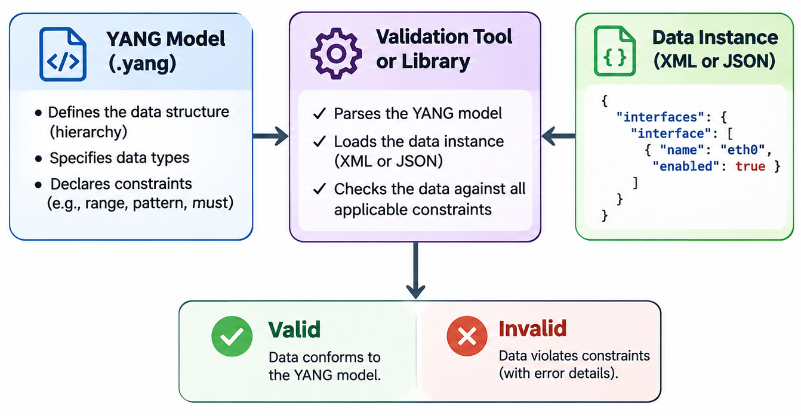
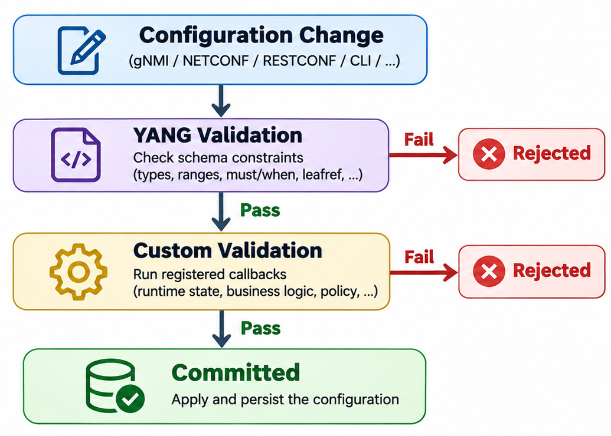

# YANG Validation

YANG is not only a language for describing data structures — it also defines the rules for determining whether a given piece of data is valid. YANG validation is the process of checking data against the constraints specified in a YANG model to ensure it is structurally correct, type-safe, and semantically consistent before it is applied to a device or stored in a datastore.

> For details on how validation is applied within SONiC specifically, see [gNMI in SONiC](./09_README_gnmi_sonic.md).

## Two Levels of Validation

YANG validation operates at two distinct levels, each addressing a different concern.

### Schema Validation

Schema validation checks that the **YANG model itself** is well-formed and internally consistent. This includes verifying that the module's syntax conforms to the YANG specification ([RFC 7950](https://www.rfc-editor.org/rfc/rfc7950)), that all referenced types and groupings are defined, that imported modules can be resolved, and that XPath expressions are syntactically correct.

Schema validation is performed at development time, before any data is involved. It answers the question: *Is the model correct?*

### Data Validation

Data validation checks that a **data instance** (a specific set of configuration or operational values) conforms to the constraints defined in a YANG model. This includes verifying that values fall within declared ranges, that mandatory fields are present, that list entries have unique keys, and that cross-references between data nodes resolve correctly.

Data validation is performed at runtime, when configuration is applied or data is received. It answers the question: *Does this data conform to the model?*

## Validation Constructs in YANG

YANG provides a rich set of built-in constructs for expressing validation rules. These constructs fall into four categories: type constraints, structural constraints, referential constraints, and conditional constraints.

> For detailed syntax and examples of these constructs, see the [YANG Language Reference](./05a_README_yang_syntax.md).

### Type Constraints

Type constraints restrict the values that a leaf or leaf-list can hold.

| Construct     | Purpose                                                      | Example                                       |
| ------------- | ------------------------------------------------------------ | --------------------------------------------- |
| `range`       | Restricts numeric values to a specified range                | `range "1..65535"`                            |
| `length`      | Restricts the length of a string or binary value             | `length "1..255"`                             |
| `pattern`     | Restricts a string to match a regular expression             | `pattern '[0-9a-fA-F]*'`                      |
| `enumeration` | Restricts a value to one of a fixed set of named options     | `enum up; enum down;`                         |
| `union`       | Allows a value to match one of several types                 | `type union { type uint16; type string; }`    |

When a data instance is validated, each leaf value is checked against these type constraints. A value of `70000` assigned to a `uint16` leaf with `range "1..65535"` would be rejected.

### Structural Constraints

Structural constraints enforce rules about the presence and cardinality of nodes within the data tree.

| Construct      | Purpose                                                                            |
| -------------- | ---------------------------------------------------------------------------------- |
| `mandatory`    | Requires a leaf, choice, anydata, or anyxml node to be present when its parent exists |
| `min-elements` | Specifies the minimum number of entries required in a list or leaf-list            |
| `max-elements` | Specifies the maximum number of entries allowed in a list or leaf-list             |
| `unique`       | Requires that a combination of leaf values is unique across all entries in a list  |
| `key`          | Identifies the leaf (or leaves) that uniquely identify each entry in a list        |

For example, if a list defines `min-elements 1`, the data must contain at least one entry in that list for the configuration to be valid.

### Referential Constraints

Referential constraints ensure that relationships between data nodes are consistent.

| Construct             | Purpose                                                                                 |
| --------------------- | --------------------------------------------------------------------------------------- |
| `leafref`             | Requires a leaf's value to match an existing value at a specified path in the data tree |
| `instance-identifier` | Requires a value to be a valid reference to an existing node in the data tree           |

A `leafref` acts as a foreign key. For example, if an interface configuration references a VLAN ID, a `leafref` constraint ensures that the referenced VLAN actually exists in the data tree. The `require-instance` sub-statement controls whether the target must exist (`true`, the default) or may be absent (`false`).

### Conditional Constraints

Conditional constraints use XPath expressions to define rules that depend on other values in the data tree.

| Construct | Purpose                                                                                   |
| --------- | ----------------------------------------------------------------------------------------- |
| `must`    | An XPath assertion that must evaluate to true for the data to be valid                    |
| `when`       | Controls whether a node is applicable based on the value of other nodes in the data tree  |
| `if-feature` | Removes a node from the schema entirely if the server does not support a declared feature |

Note that `if-feature` is fundamentally different from `when` and `must`. It is evaluated once at server startup based on static capability declarations, not at runtime based on data values. Nodes gated by an unsupported feature do not exist in the schema and cannot be configured.

The difference between `must` and `when` is important:

- A **`must`** statement is a validation rule. It applies to nodes that are present in the data tree and checks whether a condition holds. If the condition is false, validation fails with an error.

- A **`when`** statement is a gating condition. It controls whether a node is allowed to appear at all. If the condition is false, the node is not part of the effective data model, and attempting to create it will be rejected. Additionally, if a configuration change causes an existing node's `when` condition to become false, the server automatically deletes that node from the data tree (RFC 7950 §7.21.5).

## How Validation Is Performed

A YANG model by itself is a passive definition — it describes constraints but does not enforce them. To actually validate data, a software tool or library must parse the YANG model, load the data instance, and check every applicable constraint. The general workflow is:



The validation tool loads the YANG model to build an internal schema representation. It then parses the data instance (typically in XML or JSON format) and walks the data tree, checking each node against the corresponding schema definition. Constraints are evaluated in order of dependency — type constraints first, then structural constraints, then referential and conditional constraints that may depend on other parts of the data tree.

## Validation Tools and Libraries

Several tools and libraries are available for performing YANG validation. They differ in their scope, language, and intended use.

### pyang (Schema Validation)

[pyang](https://github.com/mbj4668/pyang) is a Python-based tool that validates YANG modules for syntactic and semantic correctness. It checks that the model itself is well-formed but does **not** validate data instances against the model.

```bash
# Validate a YANG module
pyang interface.yang

# Strict IETF compliance checks
pyang --ietf interface.yang

# Validate with imported modules in a search path
pyang -p ./models interface.yang
```

If the model is valid, pyang produces no output and returns exit code 0. If errors are found, it prints diagnostic messages identifying the issue and its location in the file.

pyang is the standard tool used during model development to catch errors early, before the model is deployed.

### yanglint (Data Validation)

[yanglint](https://github.com/CESNET/libyang) is a command-line tool included with the libyang library. It can validate both YANG models (like pyang) and data instances against those models. This makes it the primary tool for testing whether a specific XML or JSON document conforms to a YANG schema.

```bash
# Validate configuration data in XML format
yanglint -s -t config interface.yang data.xml

# Validate and convert XML data to JSON
yanglint -s -t config interface.yang data.xml -f json

# Validate JSON data
yanglint -s -t config interface.yang data.json
```

The `-s` flag enables strict validation (unknown data elements are rejected rather than silently ignored). The `-t` flag specifies the data type: `config` for configuration-only data, `data` for a complete datastore including operational state.

When validation fails, yanglint prints the specific constraint that was violated, the path to the offending node, and the reason for the failure.

### libyang (C Library)

[libyang](https://github.com/CESNET/libyang) is the C library underlying yanglint. It provides a programmatic API for parsing YANG models, loading data instances, and performing validation. libyang is widely used as the validation engine in network management systems, including NETCONF/RESTCONF servers and network operating systems.

libyang supports both XML ([RFC 6020](https://www.rfc-editor.org/rfc/rfc6020)) and JSON ([RFC 7951](https://www.rfc-editor.org/rfc/rfc7951)) encodings of YANG-modeled data. It covers YANG 1.0 and YANG 1.1.

### ygot (Go Library)

[ygot](https://github.com/openconfig/ygot) (YANG Go Tools) takes a code-generation approach. It compiles YANG models into Go structs, where each struct includes a `Validate()` method that checks the struct's contents against the original YANG constraints (ranges, patterns, enumerations, leafrefs, and mandatory fields).

```go
// Validate a populated struct against the YANG schema
if err := device.Interface["eth0"].Validate(); err != nil {
    log.Fatalf("Validation failed: %v", err)
}
```

This approach embeds validation directly into application code, making it particularly useful in systems that construct or consume YANG-modeled data programmatically, such as gNMI clients and telemetry collectors.

### Summary

| Tool / Library                                       | Language | Schema Validation | Data Validation | Primary Use                           |
| ---------------------------------------------------- | -------- | :---------------: | :-------------: | ------------------------------------- |
| [pyang](https://github.com/mbj4668/pyang)            | Python   | ✓                 |                 | Model development and linting         |
| [yanglint](https://github.com/CESNET/libyang)        | C        | ✓                 | ✓               | Command-line data validation          |
| [libyang](https://github.com/CESNET/libyang)         | C        | ✓                 | ✓               | Embedded validation in network systems|
| [ygot](https://github.com/openconfig/ygot)           | Go       |                   | ✓               | Code generation with built-in checks  |

## Practical Example

The following example demonstrates data validation using yanglint. We define a simple YANG model, prepare both valid and invalid data, and observe the validation results.

### The YANG Model

This model describes a network interface with a name, MTU, and administrative status.

```yang
module demo-interface {
    yang-version 1.1;
    namespace "urn:example:demo-interface";
    prefix "demo";

    container interfaces {
        list interface {
            key "name";

            leaf name {
                type string;
            }

            leaf mtu {
                type uint16 {
                    range "68..9216";
                }
            }

            leaf admin-status {
                mandatory true;
                type enumeration {
                    enum up;
                    enum down;
                }
            }
        }
    }
}
```

Save this as `demo-interface.yang`.

### Valid Data

The following XML instance satisfies all constraints: the `name` key is present, `mtu` is within range, and the mandatory `admin-status` leaf is provided with a valid enumeration value.

```xml
<interfaces xmlns="urn:example:demo-interface">
  <interface>
    <name>Ethernet0</name>
    <mtu>9100</mtu>
    <admin-status>up</admin-status>
  </interface>
</interfaces>
```

Save this as `valid-data.xml` and validate it:

```bash
yanglint -s -t config demo-interface.yang valid-data.xml
```

No output is produced, and the exit code is 0 — the data is valid.

### Invalid Data: Value Out of Range

This instance sets `mtu` to `20000`, which exceeds the declared `range "68..9216"`.

```xml
<interfaces xmlns="urn:example:demo-interface">
  <interface>
    <name>Ethernet0</name>
    <mtu>20000</mtu>
    <admin-status>up</admin-status>
  </interface>
</interfaces>
```

```bash
yanglint -s -t config demo-interface.yang invalid-range.xml
```

yanglint reports a validation error indicating that the value `20000` is not within the allowed range for the `mtu` leaf.

### Invalid Data: Missing Mandatory Leaf

This instance omits the `admin-status` leaf, which is declared as `mandatory true`.

```xml
<interfaces xmlns="urn:example:demo-interface">
  <interface>
    <name>Ethernet0</name>
    <mtu>1500</mtu>
  </interface>
</interfaces>
```

```bash
yanglint -s -t config demo-interface.yang missing-mandatory.xml
```

yanglint reports a validation error indicating that the mandatory leaf `admin-status` is missing.

### Invalid Data: Invalid Enumeration Value

This instance sets `admin-status` to `standby`, which is not one of the defined enumeration values (`up` or `down`).

```xml
<interfaces xmlns="urn:example:demo-interface">
  <interface>
    <name>Ethernet0</name>
    <mtu>1500</mtu>
    <admin-status>standby</admin-status>
  </interface>
</interfaces>
```

```bash
yanglint -s -t config demo-interface.yang invalid-enum.xml
```

yanglint reports a validation error indicating that `standby` is not a valid value for the `admin-status` leaf.

## Limitations of YANG Validation

YANG's built-in validation constructs are powerful, but they operate within a well-defined scope. There are categories of validation that YANG cannot express, and understanding these boundaries is important for designing robust network management systems.

### What YANG Cannot Validate

**No access to previous values.** YANG constraints such as `must` and `when` evaluate against the resulting data tree after a change is applied. They have no access to the data tree before the change. This means YANG cannot express rules like "this value may only increase" or "only one of these two fields may change in a single operation." XPath sees the final state, not the transition.

**No runtime or external state checks.** YANG constraints operate on data within the YANG data tree. They cannot query external systems, hardware state, or non-modeled runtime conditions. For example, YANG cannot verify that a referenced physical port actually exists on the device, that sufficient memory is available to apply a configuration, or that an IP address is not already in use on the network. These checks require access to the running system, which is outside the scope of the YANG model.

**No complex algorithmic logic.** While XPath is expressive, it is limited to what can be evaluated as a boolean expression over the data tree. Validations requiring iterative computation, lookups into external databases, cryptographic checks, or multi-step business logic cannot be expressed in YANG.

**No cross-device validation.** YANG validates data within the scope of a single device's data tree. It cannot enforce consistency across multiple devices. For example, YANG cannot ensure that both ends of a point-to-point link are configured with compatible parameters — that requires an external orchestration or validation layer.

### Custom Validation

To address these limitations, network management frameworks typically support **custom validation callbacks** — application-defined functions that run alongside YANG validation as part of the configuration commit process.

The general pattern is:

1. A configuration change is submitted (via gNMI, NETCONF, RESTCONF, CLI, or any other interface).
2. The management framework first performs YANG validation, checking all schema-defined constraints.
3. If YANG validation passes, the framework invokes registered custom validation callbacks.
4. Each callback can inspect the proposed data, query runtime state, apply business logic, and either accept or reject the change.
5. Only if both YANG validation and all custom callbacks pass is the configuration committed.



Custom validation callbacks are implemented differently depending on the management framework. Some frameworks use YANG extensions to declare validation points directly in the model, while others use event-driven subscription mechanisms where application code registers to receive proposed changes before they are committed.

The general guidance from [RFC 9907](https://www.rfc-editor.org/rfc/rfc9907.html) (YANG model guidelines) is clear: *express constraints in the YANG model whenever possible*. Custom validation should be reserved for rules that genuinely cannot be captured using YANG's built-in constructs. Keeping validation in the model makes constraints visible, portable, and enforceable by any compliant tool — whereas custom callbacks are implementation-specific and opaque to external systems.

---

**Previous**: [← YANG Module Structure](05a_README_yang_syntax.md) · **Next**: [YANG Validation in SONiC →](05c_README_yang_validation_sonic.md)
