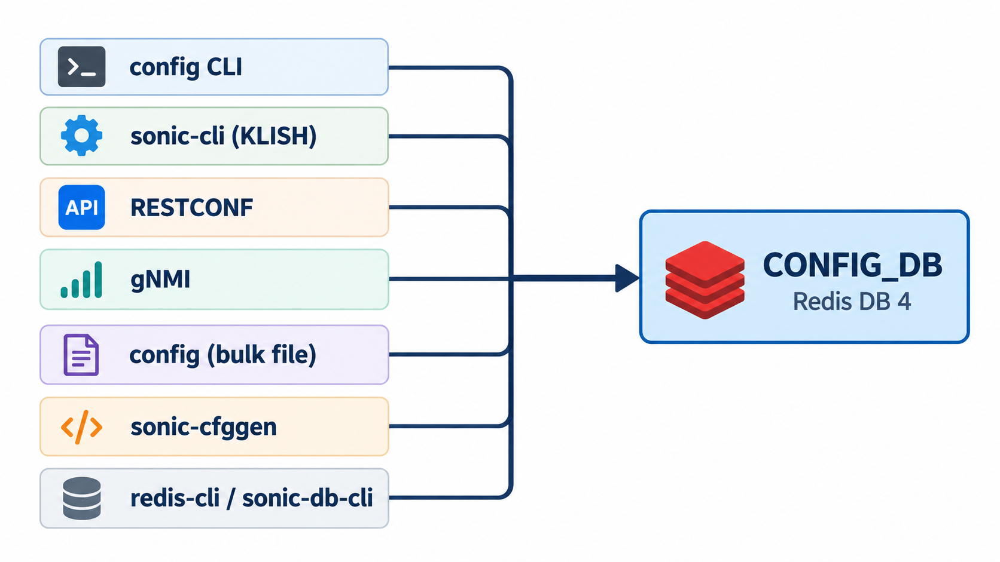
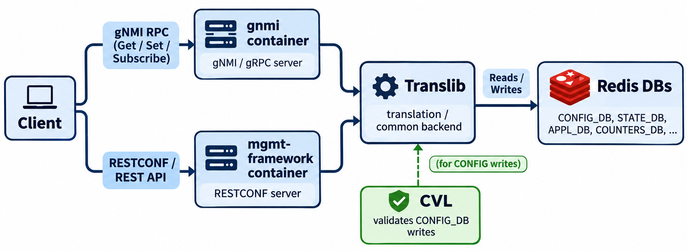
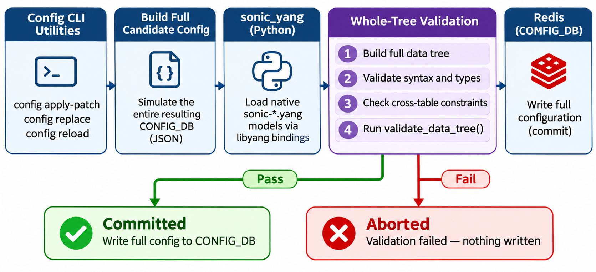

# YANG Validation in SONiC — CONFIG_DB Schema Enforcement

## The Problem: Redis Has No Schema

Multiple tools can write to CONFIG_DB — CLI commands, RESTCONF, gNMI, bulk file loads, and even raw Redis writes.



Redis itself is a plain key-value store: it accepts whatever data it is given. If a tool writes `admin_status = "maybe"` or sets `speed = "banana"`, Redis stores it without complaint. This is a problem. When `portmgrd` (the SWSS manager daemon that watches the `PORT` table) reads `admin_status`, it expects `up` or `down`. If it finds `maybe`, it may ignore the key, log an error, or apply only the fields it understands. The switch ends up in an inconsistent state that is hard to debug.

Each writing tool could implement its own validation — and some do (for example, `config vlan add` checks that the VLAN ID is between 2 and 4094). But per-tool checks are fragile: they can be inconsistent across tools, incomplete, or absent entirely. A better approach is a single, centralized schema that describes what a legal CONFIG_DB looks like, so any tool can validate against the same rules.

## How SONiC Uses YANG for CONFIG_DB

SONiC uses YANG as the schema for CONFIG_DB. The YANG models define which tables are allowed, which fields each table may contain, and which values those fields may hold. These models ship with the image and match the string values stored in Redis.

A shortened illustration — each `leaf` is a single field, and `type` / `pattern` constrain its values:

```yang
leaf admin_status {
    type string {
        pattern "up|down";
    }
}
leaf speed { type string; }
leaf mtu   { type string; }
```

The models that serve as the CONFIG_DB schema are the **native `sonic-*.yang` models**.

## Native YANG Models for CONFIG_DB

The native models live directly in the [sonic-buildimage](https://github.com/sonic-net/sonic-buildimage/tree/master/src/sonic-yang-models) repository (not a submodule):

```text
src/sonic-yang-models/
├── yang-models/      → 145 static .yang files
├── yang-templates/   → 4 Jinja2 templates (.yang.j2)
├── tests/            → YANG model test configurations
└── doc/              → CONFIG_DB schema documentation
```

SONiC defines **149 native YANG modules** across these two source locations:

- `src/sonic-yang-models/yang-models/` — 145 static `.yang` files used by CVL for CONFIG_DB validation.

- `src/sonic-yang-models/yang-templates/` — 4 Jinja2 templates (`sonic-acl`, `sonic-policer`, `sonic-extension`, `sonic-types`) that generate build-variant-specific `.yang` files (e.g., CVL vs. management framework variants).

The table below groups every native model by functional area.

| Category | Models | Key Files |
| -------- | :----: | --------- |
| **Interfaces & L2** | 22 | `sonic-port`, `sonic-portchannel`, `sonic-interface`, `sonic-loopback-interface`, `sonic-vlan`, `sonic-vlan-sub-interface`, `sonic-mgmt_interface`, `sonic-mgmt_port`, `sonic-breakout_cfg`, `sonic-lldp`, `sonic-spanning-tree`, `sonic-storm-control`, `sonic-macsec`, `sonic-mac-move-guard`, `sonic-fabric-port`, `sonic-fabric-monitor`, `sonic-fast-linkup`, `sonic-voq-inband-interface`, `sonic-system-port`, `sonic-cable-length`, `sonic-fdb-sync`, `sonic-neigh` |
| **BGP & Routing** | 19 | `sonic-bgp-global`, `sonic-bgp-neighbor`, `sonic-bgp-peergroup`, `sonic-bgp-peerrange`, `sonic-bgp-prefix-list`, `sonic-bgp-monitor`, `sonic-bgp-common`, `sonic-bgp-aggregate-address`, `sonic-bgp-allowed-prefix`, `sonic-bgp-bbr`, `sonic-bgp-device-global`, `sonic-bgp-internal-neighbor`, `sonic-bgp-sentinel`, `sonic-bgp-voq-chassis-neighbor`, `sonic-bmp`, `sonic-route-common`, `sonic-route-map`, `sonic-routing-policy-sets`, `sonic-static-route` |
| **Overlay & Tunnels** | 11 | `sonic-vxlan`, `sonic-vnet`, `sonic-nvgre-tunnel`, `sonic-tunnel`, `sonic-subnet-decap`, `sonic-evpn`, `sonic-srv6`, `sonic-mclag`, `sonic-mux-cable`, `sonic-mux-linkmgr`, `sonic-peer-switch` |
| **QoS & Buffering** | 24 | `sonic-buffer-pg`, `sonic-buffer-pool`, `sonic-buffer-profile`, `sonic-buffer-queue`, `sonic-buffer-port-egress-profile-list`, `sonic-buffer-port-ingress-profile-list`, `sonic-queue`, `sonic-scheduler`, `sonic-wred-profile`, `sonic-pfcwd`, `sonic-port-qos-map`, `sonic-dot1p-tc-map`, `sonic-dscp-tc-map`, `sonic-dscp-fc-map`, `sonic-tc-queue-map`, `sonic-tc-dscp-map`, `sonic-tc-priority-group-map`, `sonic-pfc-priority-queue-map`, `sonic-pfc-priority-priority-group-map`, `sonic-mpls-tc-map`, `sonic-exp-fc-map`, `sonic-lossless-traffic-pattern`, `sonic-default-lossless-buffer-parameter`, `sonic-trimming` |
| **ACL & Security** | 9 | `sonic-acl`\*, `sonic-policer`\*, `sonic-nat`, `sonic-copp`, `sonic-pbh`, `sonic-hash`, `sonic-fips`, `sonic-passwh`, `sonic-ssh-server` |
| **Network Services** | 10 | `sonic-dhcp-server`, `sonic-dhcp-server-ipv4`, `sonic-dhcpv4-relay`, `sonic-dhcpv6-relay`, `sonic-dns`, `sonic-ntp`, `sonic-sflow`, `sonic-snmp`, `sonic-mirror-session`, `sonic-static-anycast-gateway` |
| **System & Device** | 26 | `sonic-device_metadata`, `sonic-device_neighbor`, `sonic-device_neighbor_metadata`, `sonic-system-aaa`, `sonic-system-tacacs`, `sonic-system-radius`, `sonic-system-ldap`, `sonic-system-defaults`, `sonic-feature`, `sonic-warm-restart`, `sonic-syslog`, `sonic-logger`, `sonic-console`, `sonic-serial-console`, `sonic-banner`, `sonic-crm`, `sonic-flex_counter`, `sonic-versions`, `sonic-chassis-module`, `sonic-smart-switch`, `sonic-kubernetes_master`, `sonic-ztp`, `sonic-kdump`, `sonic-memory-statistics`, `sonic-platform-node`, `sonic-sai-profile` |
| **Telemetry & Monitoring** | 14 | `sonic-telemetry`, `sonic-telemetry_client`, `sonic-high-frequency-telemetry`, `sonic-gnmi`, `sonic-grpcclient`, `sonic-restapi`, `sonic-alarm`, `sonic-asic-sensors`, `sonic-heartbeat`, `sonic-stormond-config`, `sonic-xcvrd-log`, `sonic-auto_techsupport`, `sonic-suppress-asic-sdk-health-event`, `sonic-leak-control` |
| **Events** | 7 | `sonic-event`, `sonic-events-bgp`, `sonic-events-common`, `sonic-events-dhcp-relay`, `sonic-events-host`, `sonic-events-swss`, `sonic-events-syncd` |
| **DASH** | 1 | `sonic-dash` |
| **Other** | 4 | `sonic-debug-counter`, `sonic-fine-grained-ecmp`, `sonic-vrf`, `sonic-mgmt_vrf` |
| **Shared / Support** | 2 | `sonic-types`\*, `sonic-extension`\* |

\* Generated from Jinja2 templates at build time.

## The Two YANG Engines

The [YANG Validation](05b_README_yang_validation.md) document covers how YANG constraints work in general and introduces the generic open-source tools (`libyang`, `ygot`) that can validate data against any YANG model. SONiC builds on these foundations with two purpose-built validation engines, each tailored to a different part of the system.

### CVL (Config Validation Library)

[CVL](https://github.com/sonic-net/sonic-mgmt-common/tree/master/cvl) is a Go library in the sonic-mgmt-common repository. Internally, it uses [ygot](05b_README_yang_validation.md#ygot-go-library) for YANG-to-Go struct generation and a YANG parser built on [libyang](05b_README_yang_validation.md#libyang-c-library) (via cgo) to load the native `sonic-*.yang` models. On top of these generic foundations, CVL adds SONiC-specific logic.

CVL validates **each edit individually**. It checks the operation (create, update, delete) against the YANG model for that table. The validation sequence is:

1. **Syntax validation** — checks field types, patterns, and value ranges against the YANG `type`, `pattern`, and `range` constraints.
2. **Key validation** — verifies that list keys are present, correctly formatted, and unique.
3. **Dependent data fetch** — retrieves current database state needed to evaluate cross-references.
4. **Semantic validation** — resolves `leafref` foreign-key relationships, evaluates `must` and `when` expressions, and enforces `mandatory` fields in the context of the current CONFIG_DB state.

If a proposed change violates any constraint, CVL rejects it — the caller receives an error and the data is never written.

CVL is called by [Translib](05d_README_yang_translation_sonic.md), the shared backend that translates YANG paths into Redis operations for RESTCONF, gNMI, and the `sonic-cli` (KLISH) shell. Only after CVL returns success does the transaction proceed to the Redis `EXEC`.



> For the full request pipeline, see [gNMI in SONiC](09_README_gnmi_sonic.md#request-processing-and-data-flow).

### sonic_yang (Python)

`sonic_yang` is a Python library used by the `config` CLI utilities. Internally, it uses [libyang](05b_README_yang_validation.md#libyang-c-library) (via Python bindings) to parse the native `sonic-*.yang` models and validate CONFIG_DB data. It is the engine behind `config apply-patch`, `config replace`, and `config reload`. These commands do not validate one edit at a time. Instead, they simulate the **entire resulting configuration**, load it into `sonic_yang`, and call `validate_data_tree()` to check the whole tree at once. If validation fails, nothing is written.



Both libraries load the same native YANG model files that ship with the image. They enforce the same schema — the difference is in granularity (per-edit vs. whole-config) and which part of the system calls them.

## Which Writers Validate

Not every writer goes through a YANG engine. The table below shows which engine, if any, validates each writer:

| Writer | Validation |
| ------ | ---------- |
| `sonic-cli` (KLISH) | CVL — per-edit validation |
| RESTCONF | CVL — per-edit validation |
| gNMI | CVL — per-edit validation |
| `config apply-patch` | `sonic_yang` — whole-config validation |
| `config replace` | `sonic_yang` — whole-config validation |
| `config reload` | `sonic_yang` — whole-config validation |
| `config interface`, `config vlan`, … | Per-command checks only (no YANG) |
| `config load` | None |
| `sonic-cfggen --write-to-db` | None |
| `redis-cli` / `sonic-db-cli` | None |

A write that skips the YANG check can store a value the models do not allow. The manager daemon for that table may then ignore the key, log an error, or apply only the part it understands.

### Optional YANG Validation for `config` Subcommands

Some `config` subcommands (hostname, portchannel, SNMP, mirror session) can optionally route their writes through the same updater that `config apply-patch` uses. This happens when `yang_config_validation` is enabled in CONFIG_DB:

```text
DEVICE_METADATA|localhost → yang_config_validation = enable
```

```bash
sudo config yang_config_validation enable
sudo config yang_config_validation disable
```

When the field is absent or set to `disable`, those subcommands store the fields directly without a YANG check. `config apply-patch` and `config replace` always validate regardless of this setting.
