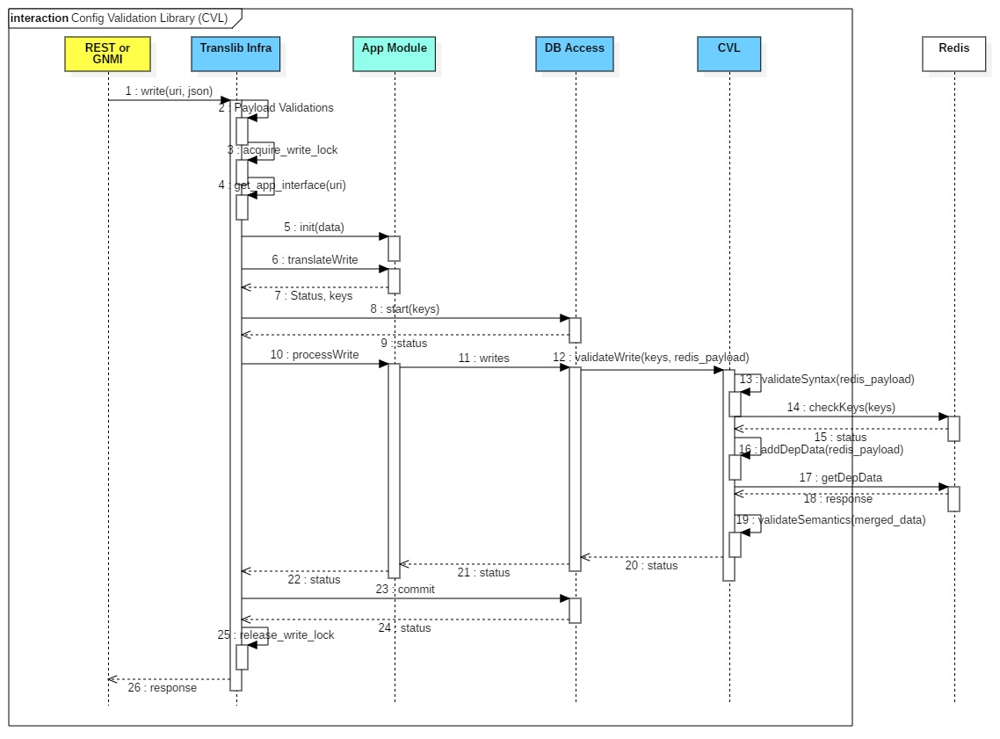

# gNMI in SONiC: Architecture and Implementation

This document builds on the concepts covered in the [gNMI guide](./08_README_gnmi.md). The gNMI specification defines the protocol, transport mechanism (gRPC over HTTP/2), and the set of RPC operations available to clients such as `Get`, `Set`, and `Subscribe`. However, the specification does not dictate how a network operating system must implement these operations internally. Each vendor or network operating system is responsible for implementing the server-side architecture that processes gNMI requests and retrieves or modifies the corresponding device data.

## Evolution of Management Interfaces in SONiC

Early versions of SONiC were primarily managed through the Linux shell or by directly modifying the underlying Redis configuration database (CONFIG_DB). While effective for manual configuration, these methods did not provide a standardized or programmatic management interface suitable for large-scale automation.

As SONiC adoption expanded into hyper-scale data centers, operators required standardized management interfaces capable of supporting telemetry streaming, structured configuration, and automation frameworks. This need led to the gradual introduction of a management architecture built around YANG models and modern APIs.

**Phase 1**: The Telemetry Container

The first step in this evolution was the introduction of the telemetry container. Its primary responsibility was to export operational statistics such as interface counters and hardware metrics to external telemetry collectors. At this stage, the functionality was limited to streaming read-only telemetry data, which is why the container was originally named telemetry.

**Phase 2**: Management Framework Introduction

As operational requirements grew, SONiC needed to support not only telemetry but also standardized configuration interfaces. This led to the development of the Management Framework, which introduced structured APIs based on YANG models. The framework enabled multiple management interfaces including REST APIs, modern CLI implementations, and gNMI to interact with the same underlying data models.

**Phase 3**: Modern Container Separation

In modern SONiC releases, the management architecture is separated into multiple containers to improve modularity, reliability, and scalability.

- `gnmi` container: Hosts the gRPC server that implements the full gNMI protocol, handling configuration updates (`Set`), state queries (`Get`), and telemetry streaming (`Subscribe`).

- `mgmt-framework` container: Provides REST-based management interfaces, primarily implementing RESTCONF over HTTPS. It also serves as the backend for the modern Klish CLI used in SONiC. This container does not run a gNMI server.

```text
admin@sonic:~$ docker ps

CONTAINER ID   IMAGE                                COMMAND                  CREATED      STATUS      PORTS    NAMES
ac44509f23a0   docker-snmp:latest                   "/usr/bin/docker-snm…"   2 days ago   Up 2 days            snmp
0750813c0cd7   docker-platform-monitor:latest       "/usr/bin/docker_ini…"   2 days ago   Up 2 days            pmon
1b028cd43318   docker-sonic-mgmt-framework:latest   "/usr/local/bin/supe…"   2 days ago   Up 2 days            mgmt-framework
23fe8bbac22a   docker-lldp:latest                   "/usr/bin/docker-lld…"   2 days ago   Up 2 days            lldp
7032bc63ca54   docker-sonic-gnmi:latest              "/usr/local/bin/supe…"   2 days ago   Up 2 days            gnmi
242694cfa411   docker-eventd:latest                  "/usr/local/bin/supe…"   2 days ago   Up 2 days            eventd
75a9a4f32543   docker-gbsyncd-vs:latest              "/usr/local/bin/supe…"   2 days ago   Up 2 days            gbsyncd
bd63fe1196a4   docker-fpm-frr:latest                 "/usr/bin/docker_ini…"   2 days ago   Up 2 days            bgp
b692bf92bdb3   docker-router-advertiser:latest       "/usr/bin/docker-ini…"   2 days ago   Up 2 days            radv
e15fd17c17e7   docker-syncd-vs:latest                "/usr/local/bin/supe…"   2 days ago   Up 2 days            syncd
2f1da17957bc   docker-teamd:latest                   "/usr/local/bin/supe…"   2 days ago   Up 2 days            teamd
1999ddccb9b1   docker-sysmgr:latest                  "/usr/local/bin/supe…"   2 days ago   Up 2 days            sysmgr
60c105b25f2d   docker-orchagent:latest               "/usr/bin/docker-ini…"   2 days ago   Up 2 days            swss
df25ca7083c4   docker-database:latest               "/usr/local/bin/dock…"   2 days ago   Up 2 days            database
```

Separating these interfaces ensures that heavy traffic on one interface such as large REST API workloads does not interfere with real-time telemetry streaming handled by the gNMI service.

## SONiC gNMI Architecture

The previous documents covered how YANG paths are [translated into Redis operations](05d_README_yang_translation_sonic.md) (Translib, annotation files, transformers) and how CONFIG_DB writes are [validated against native `sonic-*.yang` models](05c_README_yang_validation_sonic.md) (CVL). This section shows how these components fit together inside the gNMI request pipeline.

Both the `gnmi` container and the `mgmt-framework` container share the same `Translib` backend. Because both gNMI and RESTCONF use the same translation and validation layers, SONiC maintains consistent behavior across management interfaces.

## Request Processing and Data Flow

The diagram below traces the full write path. The walkthrough that follows maps each stage to the diagram's numbered steps using a concrete example: setting the MTU on `Ethernet0` to 9100 via a gNMI `Set`.



### Step 1 — Client Request

A management system sends a gNMI `Set` RPC to the SONiC switch over gRPC. In this example, the request targets:

```text
Path:  /openconfig-interfaces:interfaces/interface[name=Ethernet0]/config/mtu
Value: 9100
```

The path follows the [`openconfig-interfaces`](https://github.com/sonic-net/sonic-mgmt-common/blob/master/models/yang/openconfig-interfaces.yang) YANG model, where `mtu` is defined as a `uint16` leaf under the `config` container of each interface. The gNMI server passes the URI and JSON payload to Translib Infra as `write(uri, json)` *(diagram step 1)*. The same flow applies to RESTCONF requests from the `mgmt-framework` container.

### Step 2 — Payload Validation

Translib Infra performs initial payload validation. For OpenConfig paths, the incoming JSON is unmarshalled into ygot-generated Go structs and checked against the OpenConfig YANG model's types and constraints. This catches malformed requests before any translation begins.

### Steps 3–4 — Lock Acquisition and App Module Selection

Translib acquires a write lock *(step 3)* to ensure only one write transaction executes at a time, then calls `get_app_interface(uri)` *(step 4)* to select the appropriate App Module for the URI. For OpenConfig interface paths, this selects the transformer-based `CommonApp`.

### Steps 5–9 — Translation

The App Module initializes with the request data *(step 5)*, then calls `translateWrite` *(step 6)* to convert the OpenConfig path into Redis table, key, and field operations. Translib loads [`openconfig-interfaces-annot.yang`](https://github.com/sonic-net/sonic-mgmt-common/blob/master/models/yang/annotations/openconfig-interfaces-annot.yang) and finds three relevant annotations:

**Table selection** — the `interface` list is annotated with a table-transformer:

```yang
deviation /oc-intf:interfaces/oc-intf:interface {
    deviate add {
        sonic-ext:table-transformer "intf_table_xfmr";
    }
}
```

At runtime, the Go function `intf_table_xfmr` inspects the interface name. Because `Ethernet0` starts with `Ethernet`, it returns `PORT` as the target CONFIG_DB table. (A name starting with `PortChannel` would return `PORTCHANNEL`, `Vlan` would return `VLAN`, and so on.)

**Key translation** — the `interface` list is also annotated with a key-transformer (`intf_tbl_key_xfmr`) that extracts `Ethernet0` from the YANG path and produces the Redis key `PORT|Ethernet0`.

**Field translation** — the `mtu` leaf is annotated with a field-transformer:

```yang
deviation /oc-intf:interfaces/oc-intf:interface/oc-intf:config/oc-intf:mtu {
    deviate add {
        sonic-ext:field-transformer "intf_mtu_xfmr";
    }
}
```

The Go function `YangToDb_intf_mtu_xfmr` converts the OpenConfig `uint16` value into the string `"9100"` for Redis.

Translation returns the translated keys and status *(step 7)*. The DB Access layer then opens a CVL validation session with `start(keys)` *(step 8)* and returns status *(step 9)*.

The translated write is now:

```text
CONFIG_DB  →  PORT|Ethernet0  →  { "mtu": "9100" }
```

For full details on annotation files, extensions, and transformer types, see [YANG-to-Redis Translation](05d_README_yang_translation_sonic.md).

### Steps 10–12 — Process Write

Translib Infra calls `processWrite` on the App Module *(step 10)*, which issues the `writes` to the DB Access layer *(step 11)*. The DB Access layer calls `validateWrite(keys, redis_payload)` on CVL *(step 12)* before anything reaches Redis.

### Steps 13–20 — CVL Validation

CVL validates the translated data — not against the OpenConfig model, but against the **native** `sonic-port.yang` model, which defines the CONFIG_DB `PORT` table schema:

```yang
list PORT_LIST {
    key "name";
    leaf mtu {
        type uint16 {
            range 68..9216;
        }
    }
}
```

CVL runs four validation phases:

1. **`validateSyntax(redis_payload)`** *(step 13)* — checks field types, patterns, and value ranges. For this example, it verifies `9100` is a valid `uint16` within `68..9216`.
2. **`checkKeys(keys)`** *(step 14)* — verifies the key `PORT|Ethernet0` is correctly formatted and unique. Returns status *(step 15)*.
3. **`addDepData(redis_payload)` / `getDepData`** *(steps 16–18)* — fetches current CONFIG_DB state needed to evaluate cross-references (e.g., whether `Ethernet0` exists in the PORT table). Returns the dependent data as response *(step 18)*.
4. **`validateSemantics(merged_data)`** *(step 19)* — resolves `leafref` foreign-key relationships, evaluates `must`/`when` expressions, and enforces `mandatory` fields against the merged state.

CVL returns a pass/fail status *(step 20)*. If the client had sent `99999` (out of range) or `"banana"` (wrong type), CVL would reject at step 13 and the transaction would be rolled back.

For CVL's validation details and which writers go through YANG validation, see [YANG Validation in SONiC](05c_README_yang_validation_sonic.md).

### Steps 21–24 — Redis Commit

CVL's success status propagates back through DB Access *(step 21)* to Translib Infra *(step 22)*. Translib then issues the Redis `commit` *(step 23)*:

```text
CONFIG_DB  →  HSET "PORT|Ethernet0" "mtu" "9100"
```

Redis confirms the write *(step 24)*. Different gNMI operations target different databases:

- **CONFIG_DB** — persistent configuration data (gNMI `Set` writes here)
- **APPL_DB** — dynamic state from control-plane services (routing, MAC learning)
- **STATE_DB** — operational state (BGP neighbor status, hardware health, sensors)
- **COUNTERS_DB** — interface counters, packet statistics, queue metrics

### Steps 25–26 — Response to Client

Translib releases the write lock *(step 25)* and returns a success response to the gNMI server, which sends it back to the client *(step 26)*.

For a `Get` request, the reverse path applies: Translib reads from Redis, and the `DbToYang_intf_mtu_xfmr` transformer converts the Redis string back into the OpenConfig `uint16` response.
